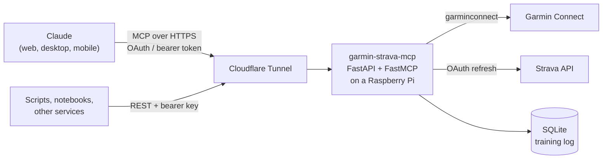

# garmin-strava-mcp

An MCP server and REST API that let Claude work with my own running data: Garmin Connect for running dynamics, training status, sleep, HRV and readiness, and Strava for activities, laps and streams. A small SQLite training log adds the structure a training block needs. I built it to train for a marathon with Claude as an analyst. It can pull a workout's splits and ground-contact time, compare them with my readiness and sleep, log the session, and track form trends week to week. All of that works from the Claude app on my phone, and the data stays on my own hardware.

## Architecture



The MCP endpoint is mounted at `/tools`. The same data is available as plain REST endpoints under `/garmin/*` and `/strava/*`, for scripts and dashboards.

## Tools

| Source | Tools |
|---|---|
| Garmin | `get_garmin_activities`, `get_garmin_activity_details` (per-second streams: GCT, vertical oscillation, stride, power), `get_garmin_activity_splits`, `get_garmin_training_status`, `get_garmin_race_predictions`, `get_garmin_lactate_threshold`, `get_garmin_personal_records`, `get_garmin_sleep`, `get_garmin_hrv`, `get_garmin_body_battery`, `get_garmin_training_readiness`, `get_garmin_heart_rate`, `get_garmin_stress` |
| Strava | `get_strava_activities`, `get_strava_activity`, `get_strava_activity_streams`, `get_strava_activity_laps`, `get_strava_stats`, `get_strava_athlete` |
| Training log | `log_run`, `log_intervals`, `get_training_log`, `update_weekly_summary`, `get_weekly_summary`, `log_checkpoint`, `get_checkpoint_history`, `get_form_trends` (3-run rolling averages) |

## Security

- Every REST route and the MCP endpoint require a bearer key, compared in constant time. The server refuses to start if the key is shorter than 20 characters.
- For Claude's custom connectors there is a minimal OAuth 2.1 + PKCE flow with dynamic client registration. The authorize page asks for the API key once and issues a 30-day token. Failed attempts are rate limited per IP and logged.
- DNS-rebinding protection allows only the configured public host and localhost. The REST API is rate limited per IP.
- Credentials live in files outside the repo (`CREDS_DIR`), and the server binds to `127.0.0.1` by default.

## Setup

Requires Python 3.11+ and [uv](https://docs.astral.sh/uv/).

```bash
uv sync
cp .env.example .env    # set API_KEY and PUBLIC_URL
```

| Variable | Required | Purpose |
|---|---|---|
| `API_KEY` | yes | Bearer key for REST and MCP (at least 20 characters) |
| `PUBLIC_URL` | for remote clients | Public HTTPS URL. Used for OAuth metadata and the allowed host. |
| `HOST`, `PORT` | no | Bind address (default `127.0.0.1:8787`) |
| `CREDS_DIR` | no | Folder holding `strava_creds.json` and `garmin_creds.json` (default: the repo folder, which git ignores) |
| `TRAINING_DB_PATH`, `OAUTH_DB_PATH` | no | SQLite files. The training-log tables are created on first use from `training_schema.sql`. |

Credential files (never commit these):

```jsonc
// strava_creds.json: from your Strava API application, after one OAuth authorization
{"client_id": "...", "client_secret": "...", "access_token": "...", "refresh_token": "...", "expires_at": 0}
// garmin_creds.json
{"email": "...", "password": "..."}
```

The Strava access token is refreshed automatically and written back to the file.

## Run

```bash
set -a; source .env; set +a
uv run uvicorn server:app --host 127.0.0.1 --port 8787
```

To use it from Claude on any device, put it behind HTTPS, for example with a Cloudflare Tunnel public hostname pointing at `http://localhost:8787`. Then add a custom connector in Claude (**Settings → Connectors**) with the URL `https://<your-host>/tools`, and enter your API key on the authorize page. On a Pi, run it under systemd with `EnvironmentFile=` pointing at your `.env`.

## Example

> **Me:** How did this morning's tempo run go compared with last week's?
>
> **Claude** *(calls `get_garmin_activities`, `get_garmin_activity_splits` for both runs, and `get_garmin_training_readiness`)*: Your tempo miles averaged 7:31/mi, 6 seconds faster than last week, at the same average heart rate (158). Ground-contact time crept up from 238 to 247 ms over the last two tempo miles, which points to fatigue late in the run. Readiness was 61 after a short night, so the effort was harder than the pace alone suggests. Should I log it?
>
> **Me:** Yes.
>
> **Claude** *(calls `log_run`, then `get_form_trends`)*: Logged as week 9. Your 3-run rolling average GCT is still down 5 ms since week 6, so the form trend is still improving.

## Tests

```bash
uv sync --group dev
uv run pytest
```

The tests cover auth on REST and MCP, the OAuth metadata, a training-log round trip (re-logging a run updates it rather than duplicating it), and Garmin login handling. A login that comes back incomplete, as can happen when the host is busy just after boot, is not cached, so the next request retries instead of failing until a restart.

## License

MIT
